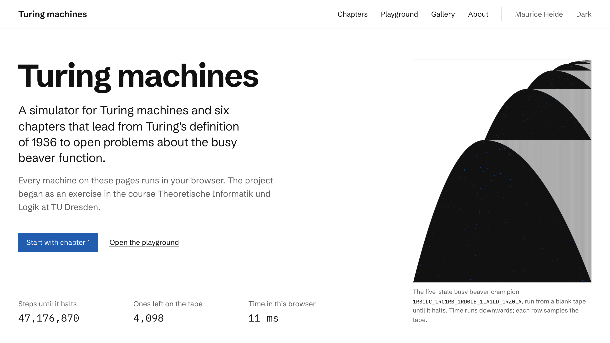

# Turing machines

A Rust workspace and a website about Turing machines, from Turing's definition of 1936 to the open
problems of the busy beaver function. The workspace contains a simulator for machines with one to
three tapes, a description language in the notation of the course Theoretische Informatik und Logik
at TU Dresden, an enumeration of small machines in tree normal form with ports of the main deciders
of the Coq-verified proof of BB(5), and a command-line tool. The website compiles the simulator to
WebAssembly and uses it in six chapters, a playground and a gallery; every machine on it runs in the
browser.

**Live site:** <https://mooofna.github.io/turing-machines/>



## What is inside

| Crate | Contents |
|---|---|
| [`turing-core`](crates/turing-core) | Machines with one to three tapes, the description language, the bbchallenge standard format and two simulators; `no_std`, no unsafe code. |
| [`turing-bb`](crates/turing-bb) | Enumeration in tree normal form, the deciders that prove machines non-halting, and the rules of the cryptid Antihydra. |
| [`turing-render`](crates/turing-render) | Space-time diagrams, the layout and edge routing of state diagrams, and SVG output. |
| [`turing-cli`](crates/turing-cli) | The command-line tool `tm`: run, trace, check, format, convert, enumerate, decide, render. |
| [`turing-wasm`](crates/turing-wasm) | Bindings for the website; the TypeScript types are generated from the Rust types. |

The website in [`web/`](web) is written with SvelteKit. The machines of the gallery are in
[`machines/`](machines), each with its origin and expected results.

## The description language

Machines are written as in the course: a transition is `δ(q, a) = (q', b, D)`, and the declarations
name the states, alphabets, start state and final states. This is the beginning of the
multiplication machine from the first exercise sheet, which reads `#x^m#x^n#` and leaves `x^(m × n)`
on the tape:

```text
machine "A_mul"
input "#xxx#xx#"
output unary x

Q = {q0, q1, q2, q3, q4, q5, q6, q7, q8, q9, q10, q11, q12}
Σ = {x, #}
Γ = {x, X, #, ␣}
start = q0
F = {q12}

δ(q0, #) = (q1, #, R)  // skip the first separator

// Take the next x of the first factor, or clean up if there is none.
δ(q1, x) = (q2, X, R)
δ(q1, #) = (q10, ␣, L)
```

The full machine is [`machines/course/unary-multiplication.tm`](machines/course/unary-multiplication.tm),
and [`docs/dsl.md`](docs/dsl.md) describes the language, its diagnostics and the standard format
`1RB1LB_1LA1RZ` used for busy beaver machines.

## Command-line tool

Install the tool with `cargo install --path crates/turing-cli`, or run it from the workspace with
`cargo run --release -p turing-cli --`.

Multiply 3 by 4 in unary, with decimal input and output:

```console
$ tm run machines/course/unary-multiplication.tm --unary 3 4
12
```

Print every configuration of a run in the notation `u q v` of the course:

```console
$ tm trace machines/course/binary-increment.tm --input 1011
 0    q0 1011
 1 ⊢  0 q0 011
 2 ⊢  01 q1 11

halted after 2 steps in state q1, output 0111 (14)
```

Run the five-state busy beaver champion:

```console
$ tm run --standard 1RB1LC_1RC1RB_1RD0LE_1LA1LD_1RZ0LA
machine   1RB1LC_1RC1RB_1RD0LE_1LA1LD_1RZ0LA
          beaver, 1 tape, 5 states and the halting state Z, 2 symbols, 10 transitions
outcome   halted after 47,176,870 steps in state Z
tape      1 Z 01001001001001001001001001001001001001001001001001001001001…
non-blank 4,098
```

Enumerate all machines with four states and determine S(4) and Σ(4), as the next section
describes: `tm enumerate --states 4`. The command `tm --help` lists all commands with examples.

## Re-deriving BB(4)

`tm enumerate --states 4` enumerates the machines with four states and two symbols in tree normal
form, in the order of Coq-BB5, and runs the deciders of the Coq proof with its parameters. Every
node is either a halting machine with a known running time or proved never to halt:

```console
$ tm enumerate --states 4
Busy beaver search over 4 states and 2 symbols, in tree normal form

stage                                         resolved   remaining
nodes of the tree normal form                              858,909
halting                                        249,693     609,216
non-halting: cyclers and translated cyclers    588,373      20,843
non-halting: n-gram closed position sets        18,134       2,709
non-halting: n-gram CPS with history             2,699          10
non-halting: n-gram CPS with LRU                     8           2
non-halting: repeated word lists                     2           0
holdouts                                                         0

S(4) = 107   1RB1LB_1LA0LC_1RZ1LD_1RD0RA
Σ(4) = 13    1RB1LB_1LA0LC_1RZ1LD_1RD0RA
```

Every count agrees with the Coq-verified enumeration, which has 858,909 nodes, of which 249,693
halt, and gives S(4) = 107 and Σ(4) = 13 (Coq-BB5, release v1.0.0). With a release build the
run takes about half a second on an Apple M1 Pro; in the browser, compiled to WebAssembly, about
one second.

## Accuracy

The deciders in `turing-bb` are Rust ports of the deciders of
[Coq-BB5](https://github.com/ccz181078/Coq-BB5), the formal proof of BB(5) in Coq. The ports
themselves are not formally verified. The tests compare them with the Coq-verified enumerations
node by node: for two and three states and for two states with three symbols in every test run,
with the enumeration files copied into `crates/turing-bb/tests/data`, and for four states in the
workflow [`verify-bb4.yml`](.github/workflows/verify-bb4.yml), which downloads the 45 MB file of
the Coq-BB5 release and checks its SHA-256 hash first. A test also checks that no decider claims
non-halting for a machine that halts. The numbers in the chapters of the website are either
computed in the browser or taken from a ledger in which every value has a source
([`web/src/content/research/`](web/src/content/research)).

## Origin

The project began in April 2024 with an exercise in the course Theoretische Informatik und Logik
at TU Dresden, taught by Prof. Markus Krötzsch and Dr. Stephan Mennicke. The first exercise sheet
asked for a Turing machine that multiplies two numbers in unary and for a program that runs it on
decimal input. The solution was a small simulator in a single Rust file, which read machines from
JSON and printed their configurations. In 2026 it was rewritten from scratch as this workspace,
and the machines of the exercise became the starting point of the chapters on the website.

## Development

The Rust toolchain is pinned in `rust-toolchain.toml`; the website needs Node.js 24 and the
`wasm-bindgen` CLI in the version of `Cargo.lock`.

```sh
cargo fmt --all --check
cargo clippy --workspace --all-targets --all-features -- -D warnings
cargo test --workspace
cargo test --release -p turing-bb -- --include-ignored   # the four-state enumeration

cd web
npm ci
npm run dev          # builds the WebAssembly engine and starts the dev server
npm run check        # svelte-check
npm run lint         # Prettier
npm test             # vitest
npm run build        # static site in web/build
npm run e2e          # Playwright, desktop and phone

python3 scripts/check_style.py   # house style, from the repository root
```

The chapters are Markdown files in `web/src/content`. They are rendered at build time with marked
and Temml; values come from the facts ledger, which `node scripts/ledger.mjs` (in `web/`)
regenerates from the research files.

## Sources

The main sources of the website are listed below; every chapter lists the sources it cites.

- A. M. Turing. On Computable Numbers, with an Application to the Entscheidungsproblem.
  Proceedings of the London Mathematical Society 42, 1936.
- Tibor Radó. On Non-Computable Functions. Bell System Technical Journal 41(3), 1962.
- Scott Aaronson. The Busy Beaver Frontier. ACM SIGACT News 51(3), 2020.
- The bbchallenge Collaboration et al. Determination of the fifth Busy Beaver value.
  arXiv:2509.12337, 2025.
- mxdys. Coq-BB5. <https://github.com/ccz181078/Coq-BB5>, 2024.
- The bbchallenge wiki, <https://wiki.bbchallenge.org>.
- Markus Krötzsch and Stephan Mennicke. Theoretische Informatik und Logik, lecture slides and
  exercise sheets, TU Dresden, summer semester 2024.

## Licence

Licensed under the [MIT licence](LICENSE-MIT) or the [Apache License 2.0](LICENSE-APACHE), at
your option (`MIT OR Apache-2.0`). The enumeration files from Coq-BB5 in
`crates/turing-bb/tests/data` are distributed under the MIT licence; see [`NOTICE`](NOTICE).

## Citation

If you refer to this project, please cite it as described in [`CITATION.cff`](CITATION.cff):

```bibtex
@software{heide2026turing,
  author     = {Heide, Maurice},
  title      = {Turing machines: a {Rust} simulator and busy beaver
                enumeration with a {WebAssembly} site},
  year       = {2026},
  license    = {MIT OR Apache-2.0},
  url        = {https://mooofna.github.io/turing-machines/},
  repository = {https://github.com/mooofna/turing-machines}
}
```
